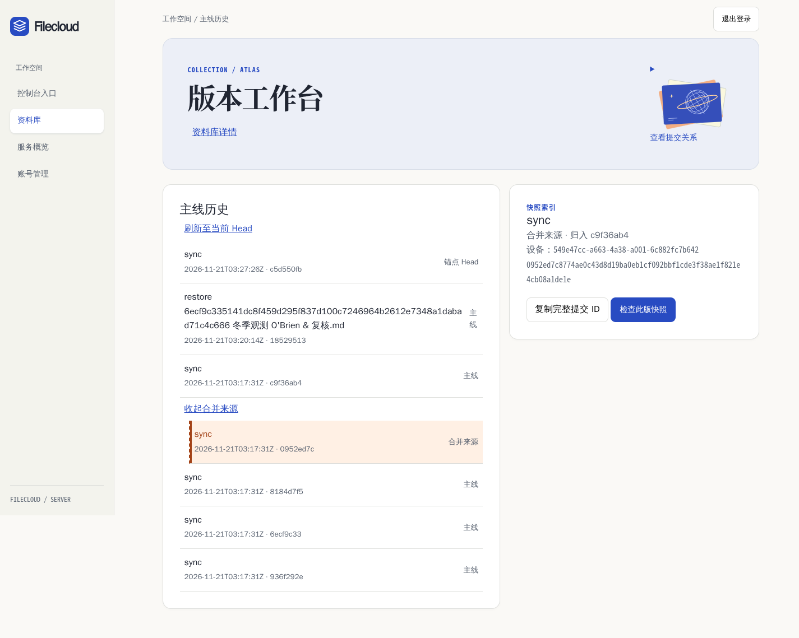

# 亮色图谱：浏览器验收（#68）

本页保留旧「图谱」界面的截图和性能样本。当前文件列表、预览和版本栏见[文件版本界面验收记录](file-versions.md)。

被测服务端：`3241bba`，Go 1.26.6，回环 HTTP，仅使用临时账号、资料库和工作目录。先从 Web 创建资料库，再在两个 CLI 工作目录产生普通提交与带合并来源的提交。检查的是运行中的服务，不是离线原型。

| 浏览器 / CSS 视口 | 已走通的操作 |
|---|---|
| Chromium 157，1440×920、320×740 | 键盘打开并创建资料库；展开合并来源、检查长中文路径、复制 CLI 预览；真实就绪检查失败与浏览器断网分别呈现「未就绪」和「未知」，恢复后再次就绪；开户、核对目标、重置密码。 |
| Firefox 160，500 px 宽，原生无头浏览器 / BiDi | 实际表单登录与创建，选择合并来源，打开固定版本的历史文件与交接命令，刷新探针，确认重置后返回账号页。 |
| WebKitGTK 2.54，800×750，临时浏览器上下文 | 同一组表单、历史与合并来源、文件检查、探针刷新、重置确认走查。 |

[窄屏历史](history-320.webp) · [窄屏交接](handoff-320.webp) · [存储未就绪](unready-1440.webp) · [重置确认](confirm-1440.webp)

**可访问性检查**：Tab/Enter 跳过导航到主要内容、可见焦点、原生表单标签、快照详情焦点目标、确认页取消、Chromium 可访问性树中的主线标题及复制动作名称；状态用文字呈现并设 live region。正文与纸白底约 14.5:1，主按钮白字与群青底约 7.3:1，来源标签橙墨与浅杏底约 5.6:1。320 CSS px、浏览器 200% 缩放（1440 → 720 CSS px）和减少动画模式分别检查。走查发现真实 restore 消息中的长 ID 撑宽标题，已修复并复测。

## 本地性能样本

Linux / Ryzen 7 9700X，Chromium 157，1440×920，已登录，在 6 个主线节点的历史页连续做 5 次冷缓存导航。用 DevTools 禁用缓存，CPU 节流 4 倍，网络延迟 40 ms、下载 500000 B/s、上传 125000 B/s。页面可见后点击复制按钮。LCP、布局偏移来自 PerformanceObserver；交互记录为点击时间戳到随后两个 requestAnimationFrame 回调的时差，是实验室反馈延迟，不是线上 INP。

| 指标 | 5 次测量 | 预算 |
|---|---|---|
| LCP | 152、160、148、152、148 ms | ≤2500 ms |
| 点击反馈 | 27.8、29.8、29.6、28.7、28.7 ms | ≤200 ms |
| CLS | 均为 0 | ≤0.1 |

复测时在临时数据目录运行服务，保存上述提交图、窗口和节流条件；用独立浏览器配置登录，每次刷新历史页后采样并点击同一按钮。产品不加载第三方分析脚本。
