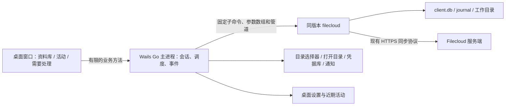

# Filecloud 桌面客户端技术方案 · 首版

**状态：已进入开发预览，正式发布验收未完成。** [构建与验证](../../desktop/README.md)。 基线 `eb3902c`，2026-11-22。需求编号 D1–D7、验收 A1–A6 见 [PRD](desktop-client-prd.md)。本文记录首版架构；当前界面与恢复交互见[新版桌面设计稿](desktop-mockups/filecloud-desktop-design.pdf)和[实现说明](../../desktop/README.md)，[三端官方资料](../research/desktop-platform-design.md)说明系统差异。

## 1. 决策：窗口不是同步引擎

同一仓库新增 `desktop/`，独立 Go module，Wails v3 + Go 应用进程、TypeScript 前端（首版采用原生 HTML/CSS 与 TS，不引入第二套控件库）。桌面安装包带**同一构建的 `filecloud-client` 子程序**，而不是调用 PATH 中的 CLI。窗口只管理绑定和解释结果；扫描、三方合并、冲突副本、Head CAS、恢复及落盘继续归 CLI。不开启服务端 Web 控制台也应能完成全部 P0。

选择子进程而不是直接调用 [`clientapp.Run`](../../internal/clientapp/app.go)：今天这个入口处理命令行流，还保留服务端命令兼容分支；独立进程可以复用现有可执行文件及锁，GUI 不需要链接整个应用或理解客户端数据库。代价是要补少量稳定的机器输出。若未来逐文件进度成为需求，再评估抽取 Go 同步接口。首版也不引入独立常驻 daemon：**当前登录用户的 Go 主进程**在关窗后继续调度即可。系统注销后运行是另一种产品需求。

仓库拟布局：`desktop/main.go` 负责启动与单实例；`desktop/frontend/` 放三端共用视图；`desktop/` 的 Go 代码按实际需要拆会话、调度、CLI 调用；`desktop/build/` 放各平台安装材料。品牌从 [`assets/brand/`](../../assets/brand/) 生成目标格式，Wails 绑定文件也从 Go 声明生成。根模块原有 `CGO_ENABLED=0` 构建和 `go test ./...` 保持独立，桌面模块单独构建和测试。

## 2. 对照现状：哪些接口要做

下表以基线版本为起点；新增均为**本机 CLI 契约**，不新增远程端点。开发预览提供 `--machine` 的成功响应/脱敏错误封套和 `sync --output=jsonl` 的流式结果，`status` 只追加可选确认字段，原命令继续可用。

| 用户操作 | 当前实现 | 首版差额 |
|---|---|---|
| 登录、列库、建库 | [`login/logout`](../../internal/clientapp/app.go) 走标准输入传秘密；[`library list/create`](../../internal/clientapp/library_manage.go) 有 JSON、分页或指定 UUID。 | Go 层消费响应，界面只接收身份及资料库摘要。建库重试复用原 UUID；按服务地址、UserId、LibraryId 关联，名称只用于展示。 |
| 本机已绑定、未绑定、首次绑定中断 | [`status`](../../internal/clientapp/library_status.go) 必须给定已有工作目录，只读一个绑定；`library list` 列的是**远端**。[绑定实现](../../internal/clientapp/library_client.go) 持久化绑定意图和首次 checkout。 | 新增只读 `library bindings --client-dir …`：枚举当前配置的绑定与未完成首次绑定（包括尚无正式绑定行的首次 checkout），返回 `libraryId, worktree, deviceId, phase`，按账号/服务限定。首次无数据库返回空集；目录丢失仍能列出记录。不返回凭据，不以读操作迁移库。远端列库失败时仅展示本机项。 |
| 导入、同步、解绑、重试 | `bind [--import-local]`、`sync`、`unbind` 已具备检查、锁和恢复语义。`watch` 在轮询期间保持绑定锁，并在本轮出错时返回。 | 桌面调度单次 `sync`，不启动长期 `watch`。为实际使用的命令新增可选机器结果和稳定错误类别；**不解析英文 stderr**。对同步只暴露必要事件，不重复扫描以计算进度。 |
| 活动、待办、确认 | `status` 返回 `SyncBase`、`Pending`、删除计数和 `NextCommand`；没有活动时间线。`sync --confirm-delete` 已核对 12 位候选前缀。 | `status` 增加可选结构化 `Confirmation {kind, candidatePrefix}`，保留旧字段。界面不执行 `NextCommand`；Go 只构造允许的确认操作。活动来源为桌面发起的真实轮次及 CLI 事件，而非逆推版本历史。 |
| 只读主线历史 | [`library history list`](../../internal/clientapp/library_history.go) 已处理历史顺序、游标，默认输出面向人。 | 提供显式 JSON 模式，包含提交摘要与下一页游标；透传已有锚点语义。首版不解析终端表格，不实现新的恢复路径。 |

**机器输出建议（v1）：** 查询输出单个 JSON；同步显式选用 `--output=jsonl`，stdout 每行一条事件，stderr 仅脱敏诊断。`scan_completed` 只从实际完成扫描的代码点发出；最后一条 `result` 给出 `ok / no_change / needs_confirmation / failed` 及稳定 `code`（如 `busy`、`offline`、`auth_required`、`unsupported_fs`、`stale_candidate`）。按真实错误类型映射，未知错误保留 `unknown`；不把所有网络错误当成口令过期。子进程退出异常或缺终态则标为中断/结果未知，重读 `status`，不写成功事件。`login` 是唯一需要解析含 token 输出的特殊管道，不接入活动采集。配套契约测试同时覆盖原 CLI 输出和新模式。

## 3. 桌面接口与状态归属

| 层 | 对外行为与数据所有权 |
|---|---|
| WebView → Go | 只暴露 `Login`、`ListLibraries`、`PickAndBind`、`RequestSync`、`SetPaused`、`ReadActivity`、`ReviewDeletion`、`ConfirmDeletion`、`OpenWorktree`、`ListHistory`、`Unbind`、`Logout` 等业务动作。既有绑定传本机绑定标识；打开目录只解析已登记的工作目录。选新目录用系统选择器。无通用命令执行、打开任意 URL 或任意路径接口。 |
| Go → CLI | 在安装位置定位 CLI，校验随包版本/commit；不匹配时禁用写操作并提示修复安装。参数数组直接传进程，不拼接 shell；秘密只用私有标准输入/输出管道。前端资源随包，远程页面、文件预览与第三方脚本不装入有本机绑定的 WebView。 |
| 同步真相 | 只有 CLI 读写 `client.db`、受限访问的绑定 token、发布候选及 journal；服务端持有已发布 Head。[领域术语](../../CONTEXT.md)、[客户端合并](../adr/0003-merge-on-the-client.md)、[前向恢复](../adr/0004-restore-history-with-a-forward-commit.md) 不变。GUI 不直连 SQLite、不自行比较文件树。 |
| 本机桌面资料 | 每个服务和所有者隔离桌面配置及 `client-dir`。配置存设备 ID、自动同步/暂停偏好、已知显示名及近期活动；首次绑定前记住用户明确选择的目录和导入意图，以相同参数恢复。成功绑定集合来自 CLI 枚举。首版用当前系统用户专属目录、单写者原子替换小型状态文件；活动最多 200 条，按账号隔离，**不是**恢复日志。丢失活动可重建待办，不影响同步。状态目录不在工作目录内，且必须通过核心文件系统检查。 |

首版只调度桌面配置明确管理的工作目录；升级沿用原 `client-dir` 与设备 ID。不要为同一工作目录另建一套客户端状态，也不扫描磁盘寻找其他 CLI 数据库。遇到用户已有 CLI 绑定时，引导保留原目录，另选新的空目录，或继续使用原 CLI；主动迁移不在首版。手工用 CLI 操作同一套状态时，仍以核心锁为准。

### 会话和隐私

桌面通过原生文件选择器之外的登录表单一次性提交口令，提交后清空；不持久化口令。Go 从 CLI 登录响应取 `Session.UserId/AccessToken/ExpiresAt`；账号级会话用于远端列库、建库、绑定和注销。为允许重开后列库，账号 token 优先放系统用户凭据库（Linux Secret Service、Windows Credential Manager、macOS Keychain）；凭据库不可用时只保存在本次进程内，提示下次列库需登录。[既有绑定 token 仍保存在受限的 `client.db`](../operations/deployment-and-client.md#6-客户端登录)，不宣称密钥环替代了现有存储。Web cookie 与桌面会话分开。

退出应用不撤销 token。退出账号则先持久标记停止调度，等在途轮次结束，再 `logout` 撤销**该会话**并清除桌面凭据；离线保留「待联网注销」和禁调度标记，不误报远端已撤销。若凭据只在内存且重启已丢失，告知远端撤销未知，本机仍停止，不用新会话冒充旧会话注销。重新登录只刷新匹配所有者的绑定；参数不变且本地与远端均收敛才可刷新。旧 token 已失效且不能刷新时，按[既有保全流程](../operations/deployment-and-client.md#刷新绑定凭据)使用新的状态目录、空工作目录和设备 ID 取回当前版本，保留原目录人工核对。

日志仅记录操作类别、错误码、结果与耗时；不记录命令行全文、管道、密码、token、用户名或路径。活动列表是本机私有 UI，以资料库标识关联名称；锁屏/系统通知不含文件名和完整路径，点击只打开待办，不能确认。生产不加载 CDN 或远端控制台到桌面窗口。

## 4. 生命周期、状态和精确确认

**调度策略。** 首版按用户会话单实例，Go 主进程管理队列。已启用的绑定递归监听工作目录，并以账号 Bearer 会话从上次已知提交开始[等待云端 Head 变化](./http-api.md#waitforheadchange)。两类通知只唤醒既有双向 `sync`：短时间内的本地变化合并，扫描开始后收到的新提示留到下一轮。每轮结束后仍安排 30 秒的定时检查；旧服务器、断网或原生监听不可用时仍可按原策略同步。整机一次只跑一个写任务，按到期顺序公平处理。定时与「立即同步」合并相同绑定的重复请求；暂停只停止新轮次，不打断发布。一个库等待确认或离线，不阻塞其他库。网络暂态由 CLI 完成本轮既有重试；轮次仍失败再按绑定退避（上限建议 5 分钟），手动可立即重试。认证失败、目录不存在或文件系统不受支持时停止该绑定自动重试，给出可执行的下一步。外部 CLI 占锁时显示「其他操作进行中」；后台任务用可取消的非阻塞取锁模式返回 `busy`，现有阻塞入口若不支持则在机器模式补齐，不删锁文件。

**关窗 / 重开 / 退出。** 最后一个窗口关闭时隐藏窗口，Go 进程仍在；同用户再次从应用菜单、开始菜单或 Dock 启动只唤起它。托盘/菜单栏是补充入口。手动退出停止定时器，不接新任务，等当前任务结束，界面显示「正在完成本轮同步」。系统注销或进程意外终止后，下次启动先枚举绑定、读取 `status`，由核心恢复未完成的工作；不重放上次点击。登录系统后启动可选、默认关，不安装系统级服务。

| `status.Pending` 或运行态 | 展示与调度 |
|---|---|
| `none` | 无待处理操作；若同一轮有成功终态才展示该轮「已完成」及时间。不从 `SyncBase` 推断当前远端无更新。 |
| `sync`、`checkout`、`restore` | 显示待继续同步/落盘/已确认恢复；未暂停时运行普通 `sync` 继续。不会产生新的用户授权。 |
| `delete-confirmation` | 停止该库自动写轮次；从本地读取计数供核对。取消或关闭后维持待办。 |
| `restore-confirmation` | 标记「历史恢复待确认」，暂停自动写入并提示回 CLI 处理；桌面不发恢复确认。 |
| 离线、会话失效、目录不可用、已暂停 | 这些是连接、绑定或调度状态，不覆盖持久的待确认事项。如同时离线并等删除确认，两者都展示；离线仍可查看计数，恢复连接并重新核对后才能发布。 |

**核对时钉住用户看见的那一批。** `ReviewDeletion(binding)` 返回资料库、工作目录、计数和该绑定当时的候选前缀；Go 将此次核对与绑定、前缀和计数关联。`ConfirmDeletion(review)` 在同一绑定队列中重读状态；不同、已完成或待办消失就返回 `stale_candidate`。匹配才向随包 CLI 传**原核对的** `sync --confirm-delete <12位前缀>`。最终校验仍由[核心发布流程](../../internal/clientapp/publication_sync.go)在锁内完成：工作目录变化、Head 前移或候选重算时，按核心结果刷新界面；不把旧确认换成最新前缀重试。结果未知时普通 `sync` 核实已发布与否，若出现新的确认待办则重新问用户。这里的 82/240 是示例，不硬编码阈值或在 GUI 重算删除数。

## 5. 原生交付与验证

锁定 [Wails v3.1.0 稳定标签](https://github.com/wailsapp/wails/releases/tag/v3.1.0)，常规后端；桌面 CLI、Go module 和前端 runtime 同步锁定版本。三端差异集中在唤起、凭据、通知、选择/打开目录和打包。优先使用 Wails 的原生能力，设计参考不是要求另写三套 GTK/WinUI/AppKit 界面。版本选择依据见[Wails 调研](../research/wails-desktop.md)。

| 桌面首发目标（拟） | 安装/验收重点 |
|---|---|
| Ubuntu 24.04 / GNOME，amd64，ext4 | 提供 `.deb` 与复用同一 GUI/CLI 的免安装 `.AppImage`，`.deb` 使用系统 GTK 4/WebKitGTK 6，AppImage 随包携带两者、对应的 WebKit 辅助进程及资源，使用主机的 glibc、图形驱动和沙箱工具，带 `.desktop` 入口和应用图标；在目标桌面从菜单启动、禁用托盘扩展后重开，验证状态目录与工作目录都在本地 ext4。 |
| Windows 11，amd64，固定 NTFS | 用户级安装包，检测 WebView2，缺失时给可执行提示；测试开始菜单、原生目录选择、125%/200% DPI、路径含空格、受限 ACL 和卸载保留数据。公开发行前验证安装包及随包程序签名。 |
| macOS，arm64，APFS | `.app` 随 DMG；主包和内嵌 CLI 一起签名、做公证，在干净系统从 Finder 启动。测试 WKWebView、Keychain、Dock 重开、⌘Q 和目录访问被拒绝后的提示。最低系统版本以实际签名包验证后填写。 |

依赖与上游支持范围以[固定版本安装文档](https://github.com/wailsapp/wails/blob/v3.1.0/docs/mpress/content/getting-started/installation.md)为准。GUI 安装包与 CLI/服务端归档分别打包，同 tag/commit、同一个 GitHub Release；单独收集桌面 Go、前端和随包依赖的许可证。升级先退出旧实例、替换 GUI 与 CLI 整包，保留用户状态与工作目录；升级失败不自行降级数据库。首版手工安装更新，不做静默自更新。

## 交付顺序与门禁

| 里程碑 | 交付边界 | 必须拿到的证据 |
|---|---|---|
| M0 · 最小安装包 | 不做全套页面；三端窗口 + 同版本 CLI，关闭后一次同步，再唤回。 | 在三台原生目标机安装成功；无托盘也能重开，关窗后另一台设备收到文件。先解决原生依赖或签名阻塞。 |
| M1 · 绑定与数据契约 | 实现只读本机绑定枚举、机器输出、登录/建库/绑定和只读主线历史。 | CLI 契约 fixture 与真实服务端：分页、首次导入确认、双非空拒绝、首次 checkout 中断、旧版 CLI 默认输出不变。覆盖 A1、A5。 |
| M2 · 完整主流程 | 后台调度、活动保留、待办、精确确认、注销和各端原生入口。 | 两设备真实收敛；候选过期、暂不处理、重启恢复、会话失效、CLI 占锁及无明文凭据；覆盖 A2–A5。保留每端脱敏结果和截图。 |
| M3 · 发布 | 独立桌面构建任务、打包、签名/许可、安装/升级冒烟与无障碍检查。 | A1–A6 全部通过；根模块的 [1B / 1C 和双二进制冒烟](../distribution.md)继续通过。原生验收遵循[主机指南](../agents/acceptance-hosts.md)，不能用交叉编译替代。 |

**评审后首先验证的未知项：** 当前三台目标主机的具体系统/图形运行时组合、用户级唤起与隐藏后的行为、签名凭据和发布渠道是否就绪。M0 记录真实结果再承诺支持矩阵；这些不是新增服务端协议或重写同步核心的前置理由。
