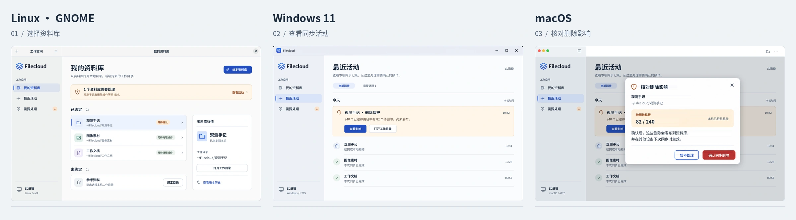

# Filecloud 桌面客户端 · 资料库与同步活动预览

状态：第二轮静态评审稿，沿用原预览图路径。三张图展示同一个流程的三个时刻，三端共用这些操作。资料库、路径、时间和活动都是示例数据。

| 单端高清稿 | 建议走查的问题 |
|---|---|
| [Linux / GNOME：我的资料库](screens/linux.png) | 能否区分「已绑定」和「未绑定」？选中「观测手记」后，详情显示它绑定的工作目录，可直接在本机打开；未绑定的「参考资料」则提供「绑定目录」。 |
| [Windows 11：最近活动](screens/windows.png) | 哪次同步需要介入？按时间列出本机活动，将「等待确认」和「本次同步已完成」分开。警告给出两个就近入口：「查看影响」和「打开工作目录」。 |
| [macOS：核对删除影响](screens/macos.png) | 是否知道确认会影响其他设备？面板列出资料库、工作目录和数量：已跟踪的 240 个路径中有 82 个待删除。「暂不处理」保留待确认状态，只有「确认同步删除」才同意发布这批删除。 |

## 品牌素材

三端侧栏使用同一份 [Filecloud 横版 Logo](../../../assets/brand/filecloud-logo.svg)，Windows 标题栏使用[应用图标](../../../assets/brand/app-icon.svg)。叠层标识只代表产品；资料库、活动和删除保护分别使用文件夹、活动线和盾牌图标。生成时将品牌素材和各端布局一起作为输入，成稿按项目术语校准文字。横向总览直接由三张单端稿缩放排版。

## 设计依据

| 来源 | 在 Filecloud 稿子里的取舍 |
|---|---|
| Seafile 官方：[安装与同步资料库](https://help.seafile.com/syncing_client/install_sync/)、[绑定已有目录](https://help.seafile.com/syncing_client/syncing_existing_folders/) | 借鉴「先选资料库，再关联本地目录」。把绑定状态和工作目录放在资料库旁，不把桌面首页做成远端文件浏览器。 |
| Nextcloud 官方：[使用桌面同步客户端](https://docs.nextcloud.com/server/stable/user_manual/en/desktop/usage.html) | 借鉴在主界面集中展示最近活动、异常和打开本地目录的入口。本稿用「查看影响」先看范围，避免从状态列表误触删除。 |
| Filecloud：[本地状态与删除计数](../../../internal/clientapp/library_status.go)、[删除保护规则](../../../internal/clientapp/library_sync.go) | 「无待处理操作」对应本地状态，不用它推断远端是否有更新。活动列表是桌面设计提案；当前 CLI 的离线状态并不返回带时间戳的活动流。 |
| 平台：[GNOME Header Bars](https://developer.gnome.org/hig/patterns/containers/header-bars/) · [Windows 标题栏](https://learn.microsoft.com/windows/apps/design/basics/titlebar-design) · [Apple 工具栏](https://developer.apple.com/cn/design/human-interface-guidelines/toolbars) | GNOME 将菜单与添加入口放在标题栏；Windows 保留应用图标和右上窗口控件；macOS 保留左上窗口控件，核对时将注意力集中到当前窗口的确认面板。 |
