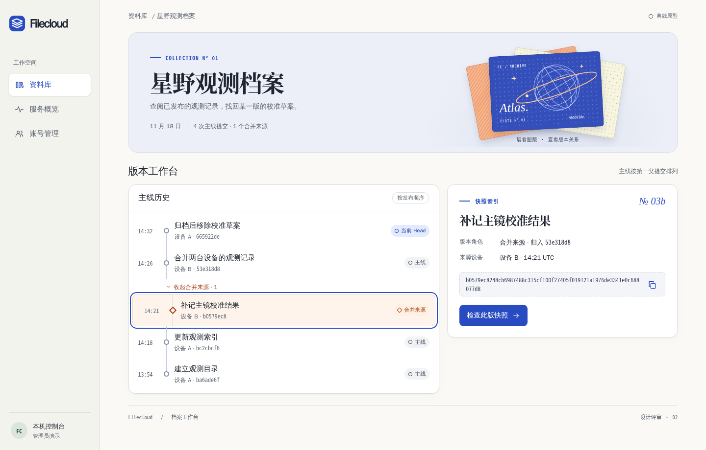

# 星野观测档案 · 亮色原型 02

打开同目录的 **[index.html](index.html)** 即可体验；在 GitHub 上请点 **Download raw file**，下载后双击。不需要启动服务、联网或输入密码。所有提交、账号和操作都是示例。本轮只重做 [#58](https://github.com/finalmaybe/filecloud/issues/58) 的交互与视觉，未接入服务端。

## 先试这三个组件

参考来源：[DesignBookmark · Motion](https://designbookmark.com/motion)。下面列的是该页面的组件名，原型用本地 CSS、SVG 和浏览器原生按钮重新实现，不加载站外脚本、图片或字体。

| 参考组件 | 在哪儿试 | 交互与用途 |
|---|---|---|
| **Fan cards** | 点击页首蓝色星图，或聚焦后按 Enter | 叠放的图版展开，从封面切到提交关系图：实线圆点是四次主线发布，虚线菱形是 14:21 的来源，在 14:26 合入。再点一次收回。[展开截图](screens/desktop-map.webp) |
| **Tab pill** | 切换「A 图谱 / B 账本 / C 引导」 | 选中底板滑到对应标签，三种版式共用当前所选提交。桌面开关浮在底部，窄屏放在工作台标题下，不遮挡命令。焦点位于开关内时支持左右键。 |
| **Copy button** | 点击完整提交 ID 旁的复制图标，或恢复页的「复制预览命令」 | 剪贴板写入成功后，原按钮就地变成勾号，并播报结果；浏览器不允许访问剪贴板时选中文字，提示手动复制。 |

## 两分钟走查

1. **找回校准草案。** 在历史页展开 14:26 提交下的「合并来源」→ 选择 14:21 的「补记主镜校准结果」→「检查此版快照」→「观测报告」→ 点击文件 →「获取恢复预览命令」。核对命令用的是**所选来源的完整提交 ID 和原路径**，而不是当前 Head。真正的预览、确认都在绑定设备的 CLI 上执行。
2. **核对重置影响。** 在「账号管理」点击「核对重置影响」，确认目标是 `observer-02`，其 Web 和 CLI 会话都将失效。按 Esc 回到触发按钮，也可重新打开并确认模拟操作。

「资料库」中还有一个尚未发布的空库。「服务概览」的模拟场景能分别演示进程存活但存储未就绪、连接中断时两项均未知。

## 版式与视觉约定

| 版式 | 适合什么任务 |
|---|---|
| **A · 图谱（推荐）** | 来回对比相邻版本。选择在左，详情在右，合并来源收在所属提交下。手机先选版本，再聚焦下方的快照标题。 |
| B · 账本 | 按列扫描设备和版本角色，详情在选中行下方展开。 |
| C · 引导 | 偶尔做恢复：第一步选版本，第二步核对快照。 |

- **纸与墨**：纸白画布 `#FAF9F6`、正文 `#202532`、群青主操作 `#284BC2`、橙墨合并来源 `#A34217`。中文标题用本机衬线字，正文用无衬线，哈希和时间用等宽字体。正文/画布 14.54:1，白色主按钮文字/群青 7.30:1，橙墨文字/浅杏底 5.62:1。
- **节奏与反馈**：历史行至少 56 px，面板间隔 16 px，键盘焦点环 2 px。图版展开 360 ms、选中底板移动 230 ms、复制勾号出现 200 ms。系统要求减少动画时直接显示最终状态。危险操作仍用有文字说明的确认框，无需长按、滑动或计时。

## 浏览器走查记录

桌面 **1440×920** 与窄屏 **320×740** 均用 Chromium 直接打开本地 HTML：走通上述两条任务，检查 A/B/C 切换和刷新、图版展开、复制反馈、空库、存储异常与断连、长路径、弹窗取消/确认与焦点返回。关键页面无整页横向溢出或脚本错误；减少动画模式下图版过渡为 `0s`。

| 场景 | 实测截图 |
|---|---|
| 主线与合并来源 | [桌面](screens/desktop-history.webp) · [窄屏](screens/mobile-history.webp) |
| 设备端恢复交接 | [长路径与预览命令](screens/mobile-handoff.webp) |
| 空库与异常 | [空库](screens/desktop-empty.webp) · [存储未就绪](screens/desktop-unready.webp) · [连接中断](screens/desktop-offline.webp) |
| 账号重置确认 | [桌面](screens/desktop-reset.webp) · [窄屏](screens/mobile-reset.webp) |

当前评审的是亮色方向和上述交互；生产界面仍等待维护者确认。旧版保存在评审分支的提交 `3df9721` 中。
