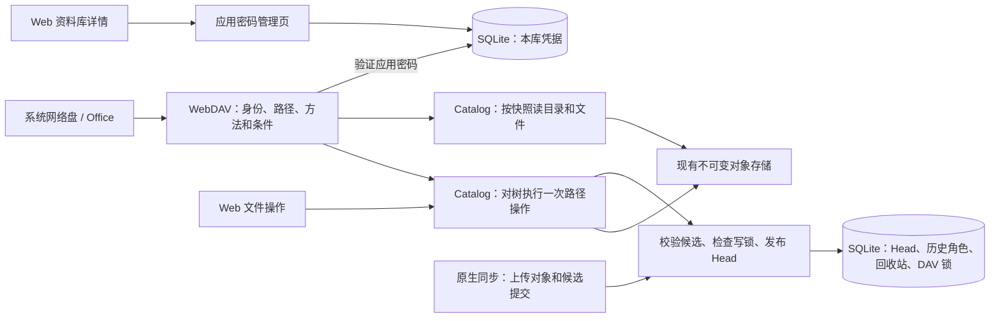

# 可写 WebDAV：把资料库挂成办公网络盘

**状态：源码版已实现，默认关闭。** [启用方法](../operations/deployment-and-client.md#启用-webdav-网络盘) · [验收记录与尚待实测的客户端](../acceptance/webdav-office.md)。 面向一个人用多台设备访问自己的资料库。不同账号共享资料库、Office 多人实时协作不在首版范围内。

**从网页到网络盘：** 登录 Web → 打开资料库详情 → 选择侧栏的 **「应用密码」** → 在独立管理页创建应用密码 → 用页面给出的地址和凭据挂载该资料库。此后打开和保存文件不需要保持网页登录。

首个验收场景是在 Windows 资源管理器挂载资料库，用 Word 打开已有 `.docx`，连续保存两次并关闭；另一台绑定设备执行 `sync`，得到最后保存的内容。若误删文件，到 Web 资料库详情的「回收站」恢复；若覆盖错了，到该文件的「历史版本」取回保留期内的旧稿。

## 1. 入口和改动边界

浏览器管理入口和网络盘 `/dav/` 默认关闭。用 `--site-url https://<公开主机>` 在同一地址启用两者。用户挂载 `/dav/<LibraryId>/`；资料库显示名通过 `displayname` 返回，改名不改变挂载地址。DAV 根只列当前凭据授权的库，不能通过创建、移动或删除顶层目录来增删资料库。首版只操作**同一资料库当前已发布的文件树**，历史、回收站和恢复沿用 Web / CLI。

| 落点 | 复用什么，改什么 |
|---|---|
| [`internal/serverapp`](../../internal/serverapp/serverapp.go)、[`internal/dav`](../../internal/dav/handler.go) | 前者挂载路由；后者处理 DAV XML、方法、条件头、状态码。路由按公开 origin 解析请求，不把 URL 交给本机文件系统。 |
| [`internal/library`](../../internal/library/snapshot.go) | [`DAVTree`](../../internal/library/dav.go) 固定 Head，复用快照路径解析和[按块校验的文件读取](../../internal/library/file_version.go)。[`replacePathEntry`、`publishWebRoot`](../../internal/library/file_version_changes.go) 和[回收站树操作](../../internal/library/trash.go)是写入起点：抽出按路径变更并发布的能力，让 Web 与 DAV 共用；保留 Web 恢复自己的锚点和已占用检查。 |
| [`internal/storage`](../../internal/storage/libraries.go)、[`internal/auth`](../../internal/auth/auth.go) | 增加 DAV 专用凭据、持久写锁的 SQLite 迁移。扩展现有 `PublishHead` 事务及所有发布入口；复用对象写入、上传预算、发布历史和在线 GC 协调。 |
| [`internal/webconsole`](../../internal/webconsole/shell.html) | 在资料库详情侧栏增加「应用密码」，沿用本库的导航、Web 会话和服务端表单。首版只从网页管理凭据，不新增 CLI 凭据命令。 |
| 原生客户端、桌面端 | 保留现有绑定、对象格式和发布流程。新客户端识别网络盘占用提示，旧客户端遇到锁仍须保留待发布内容。 |

不把 `webdav.Dir` 指向 `--data-dir`，也不在服务端建工作目录再跑 `watch`：前者暴露的是对象存储布局；后者会让“编辑器收到保存成功”和“版本已发布”成为两件事。协议库可复用解析代码，但一次 `MOVE` 必须作为**一次资料库操作**提交，不能委托给会逐项写入的文件系统复制逻辑。

## 2. 应用密码：按资料库管理

**一个应用密码只授权一个所有者的一个资料库；同库可签发多个。** 建议每台设备各用一个，便于单独撤销，但服务端不绑定物理设备。同一凭据可在两台设备挂载，提交记在同一逻辑设备 ID 下。撤销该凭据后，两台设备都失去访问权；使用其他有效凭据的挂载不受影响。

### Web 资料库详情 → 应用密码

「应用密码」与「回收站」「保留设置」同属当前资料库侧栏。点击后进入独立页面，不在文件列表弹窗中管理。页面显示库名，并可返回该库的文件列表。

| 页面操作 | 用户看到的结果 |
|---|---|
| 查看与挂载 | 文件列表样式的表格显示凭据名称和本地创建时间。点击名称或行内「… → 查看」，可见状态、到期时间、挂载用户名，并可在弹窗内复制挂载地址。 |
| 创建应用密码 | 点击标题同行的「创建应用密码」，在弹窗中输入便于识别的名称，如「办公电脑」，确认后签发。服务端生成 26 位随机应用密码（同时含大写字母、小写字母和数字）及逻辑设备 ID。「应用密码已创建」弹窗列出地址、用户名和**仅此次可见**的密码，每项右侧都有复制图标。关闭后返回列表。提示保存到系统凭据管理器；以后忘记密码就创建新的并撤销旧的。挂载地址不含密码。 |
| 删除应用密码 | 在行内「… → 删除」核对名称和影响，确认后从列表移除。服务端撤销此凭据并释放其写锁，所有使用它的挂载都失去访问权；取消不改变状态。 |

管理入口使用服务端 HTML 表单。设 `P = /libraries/{LibraryId}/app-passwords`：`GET P` 显示页面，`POST P` 创建，`POST P/{CredentialId}/revoke` 撤销。创建结果直接通过 `Cache-Control: no-store` 的 HTML 响应展示，不将密码放入 URL、重定向、列表、Web Storage 或日志，不用 JSON 接口向脚本返回密码。库的所有者来自已验证的 Web 会话，不从表单读取；撤销时按所有者、库和凭据 ID 一起查询。沿用[Web 控制台契约](./web-console.md)的 Host 校验和表单写入 Origin 校验；跨库凭据与不存在的凭据统一返回 `404`。

### 网络盘认证与路径

- 挂载使用 **HTTPS + HTTP Basic**：用户名填页面给出的凭据 ID，密码填应用密码，不填账号主密码。数据库保存随机密码的摘要、凭据名称、所有者、库 ID、逻辑设备 ID 和有效期、撤销状态，不保存明文。
- 浏览器管理页只接受 Web 会话；网络盘不接受 Web Cookie、CLI Bearer 或账号主密码。应用密码不能访问浏览器页面、`/v1` 或签发其他凭据。退出网页不影响挂载；账号重置密码沿用[现有事务](../../internal/storage/accounts.go)，同时撤销该账号的全部 DAV 凭据及其锁。
- 生产 TLS 由可信反向代理终止，保留外部 Host、DAV 方法、`Destination`、`If`、`Lock-Token`、`Depth` 和 `Range`。校验 Host；请求携带浏览器 `Origin` 时必须匹配，原生客户端可不发。认证在查路径、查锁之前：无凭据返回 `401` + Basic challenge，他人资料库与不存在统一 `404`。日志只记方法、结果码、耗时和字节数，不记凭据、锁令牌、原始 URL、文件名或 XML 正文。
- 源 URI、`Destination` 和 `If` 中的资源 URI 共用一套解析：先校验作用域，再逐段解码一次、转 NFC，应用[协议路径规则](./architecture.md#路径规则)。拒绝编码分隔符、点段、保留名和歧义路径；不要先用路径清理器重定向写请求。跨主机或跨库的目标不发起网络请求。同目录大小写折叠冲突不能覆盖其他条目；仅改大小写的同一源项用一次 `MOVE` 完成。

## 3. 网络盘看到的协议

| 操作 | 首版契约 |
|---|---|
| `OPTIONS`、`PROPFIND` | 返回实际能力和 `Allow`。支持 `Depth: 0/1`、`allprop`、`propname`、指定属性以及 `207 Multi-Status`；无限深度返回 `403` 和 `propfind-finite-depth`。返回名称、类型、文件长度、修改时间、资源 ETag、`supportedlock`、`lockdiscovery`；未知属性单独返回 `404 propstat`。一次列表固定一个提交，列完全部直接子项或明确报超限，不把现有 50 项的网页分页当成完整目录。 |
| `GET`、`HEAD` | 文件从同一提交按块校验并读取；支持 Range、条件读取、`304` 和零字节文件。`HEAD` 只读元数据。内容流关闭前保持该库的前台活动登记。 |
| `PUT`、`MKCOL` | 创建文件或空目录返回 `201`，替换文件返回 `204`。父目录必须已存在；缺父目录 `409`，不能用 PUT 把目录变成文件。只在收完整个请求并成功发布后报告成功。 |
| `MOVE`、`COPY` | 同库内操作，`Destination` 必填。`Overwrite: F` 且目标已存在返回 `412`；省略等同 `T`，仍须满足下文的防覆盖条件。目录 MOVE 整棵子树；目录 COPY 支持深度 0（仅空目录）或 infinity。复用对象 ID，不搬运文件字节。拒绝目录移入自身子树、覆盖源的祖先以及对资料库根的写操作。 |
| `DELETE` | 删除文件或目录树，一次发布；目录按一个条目进入本库回收站，保留随附历史，沿用当前 `TrashDays` / `HistoryDays`。DAV 的显式删除与原生客户端“扫描发现大量删除”的确认流程分开。 |
| `LOCK`、`UNLOCK` | 排他写锁，支持申请、无正文续租、超时、释放及发现。读文件不需写锁。锁未映射的地址时按标准**创建一个真正的零字节文件**：空文件发布和加锁同事务成功，解锁后文件仍在。 |
| `PROPPATCH` | 解析并按请求顺序原子处理整组属性。首版不持久化任意客户端自定义属性；受保护或不支持的设置返回逐属性失败（`403/424`），不假报写入。若目标客户端把某个时间属性作为保存的必要步骤，在兼容验收中确认其语义后再映射到目录项。 |

`DAV: 1,2` 只在对应符合性用例通过后宣告。Office 的 `OPTIONS` 探测单独验证，可宣告 `MS-Author-Via: DAV`；不宣告未实现的 `X-MSDAVEXT` 或协作协议。若客户端强制探测 `OPTIONS /`，须单独验证兼容性；`/` 保留给 Web 入口。

## 4. 一次保存怎样才算成功

以“编辑器写入临时文件，再用它替换 `预算.xlsx`”为例。编辑器看见的是路径，原生同步看见的是提交：

1. 打开文档时读取文件自身的强 ETag。它由规范的 `(类型, 对象 ID, 修改时间)` 生成，与资料库的 `head-version` 分开。别人改了同目录的另一个文件，不会让该文档的 ETag 变化。客户端可以先持锁再读，或者拿读取时的 ETag 条件加锁；无条件加锁只保护获锁之后的编辑。
2. `PUT 临时文件` 流式拆成现有的 4 MiB 内容块，写入 File 和涉及的 Directory，再发布一个提交。临时文件是普通文件，原生设备可能看见；不按 `~$`、`.tmp`、`._` 等名字吞写或自动删除。如果下一步失败，这份已保存的临时稿仍可另存。
3. `MOVE 临时文件 → 预算.xlsx` 在**同一棵候选树**上移除源、替换目标，跨目录时同时重建两条祖先链。只发布一个提交。成功后其他读者看到完整的新文档；失败时临时文件和原文档均留在上一步的位置。目标上的锁按 RFC 保留，源上的锁不随文件搬迁。`COPY` 不复制源锁。
4. 成功响应后，Web 和 DAV 读取同一个新 Head，绑定设备照常同步。一次应用层“保存”可以有数个请求和提交；只保证**每个变更请求**原子，不把独立的 `DELETE` 和后续 `PUT` 伪装成原子替换。若客户端用“先删原件再上传”且断线后丢失原件路径，该组合须单列限制，不能按上述原子保存链路验收。

### 防止旧稿覆盖新稿

| 服务端看到的情况 | 决定 |
|---|---|
| 新建不存在的目标 | 允许；接受 `If-None-Match: *`、`Overwrite: F`。请求过程中目标被别人创建时，不改为覆盖。 |
| 覆盖已有文件或已有 `MOVE/COPY` 目标；删除已有项 | 必须有作用于该目标的具体强 ETag 或有效写锁令牌。没有版本依据返回 `428`；条件不成立返回 `412`；资源已锁而未提交所需令牌返回 `423`。`If-Match: *`、文件日期、同一账号和 `Overwrite: T` 都不能证明读过哪一版。简单改名到空位置可以移动当前源项，仍须尊重源上的锁及客户端给出的源条件。 |
| 锁或 ETag 在另一路径上 | 按 RFC 4918 解析带标签和不带标签的 `If`、条件列表和 `Not`，不从文本中搜令牌。HTTP `If-Match` 对 MOVE 校验的是**源**；覆盖目标要用标明目标 URI 的条件或有效的目标锁证明。源、目标及受影响父目录各自需要的锁都要提交。 |
| 上传期间同库 Head 前进 | 最终 CAS 使用构造候选时的 `(CommitId, HeadVersion)`。若仅无关路径变化，最多按新 Head 重做一次相同操作：源/目标条目、父目录可用性、目标名称占用及全部条件、锁必须仍符合原意。相关项已变则停止；客户端条件过期返回 `412`，其他树冲突或第二次竞争返回 `409`。不对 Office 二进制做服务端合并。 |

**兼容性取舍：**只会无条件覆盖、又不使用锁的挂载器可以浏览和新建文件，不能列为可办公客户端。请求开始时才读取 Head，可以防上传过程中的竞争，却看不见用户打开旧文档后离线编辑的那段时间。D0 必须先验证目标组合实际提供的条件或锁，以及冲突时用户能否另存稿件。

## 5. 写锁必须约束原生同步和网页

只在 DAV handler 里加锁，Word 会显示“已锁定”，但另一台设备仍能发布新内容。锁要放在**所有改变 Head 的入口共用的发布检查**上；不拦对象上传、不锁整台设备，也不锁用户的本地工作目录。

- SQLite `dav_credentials` 存凭据及其作用域；`dav_locks` 以所有者、库、规范路径定位，存凭据 ID、唯一锁令牌、深度及 UTC 失效时间。两表沿用库复合键和现有迁移流程。锁令牌只在已认证范围内使用，不能单独授权。建议初始租期 10 分钟、单次最多 1 小时；响应给出实际时长。重启保留未过期锁，过期、主动撤销凭据后可重新申请。
- 支持文件和集合的排他锁。集合 `Depth: 0` 保护集合自身和直接成员名的增删，不阻止未锁子文件仅修改内容；`infinity` 保护整棵子树。移动、覆盖或删除祖先时也检查其下受影响的锁。成功删除清理被移除资源的直接锁；继承自父集合的锁仍有效。
- 在单节点现有按库 Head 验证槽的基础上，让锁授予、续租、解锁与最终发布检查按库排序。**不在上传或下载文件时占用发布槽。** 锁查询、校验及最终 CAS 不能留下“检查后、发布前又有人拿到锁”的空档；原生 `updateHead` 持有验证槽到 `PublishHead` 返回；事务内还会重新读取有效凭据和锁，防止长时间上传沿用失效令牌。涉及锁变化的写入（如 LOCK 新文件、MOVE、DELETE）把锁变更与 Head、历史角色和回收站变更放在同一个 SQLite 事务；锁过期及凭据撤销在最终写入时复核。
- 原生候选没有 DAV 路径清单：先取本库有效锁，无锁走原发布路径；有锁时对**旧根和候选根中锁定路径**做比较。文件比较完整目录项，无限深目录比较该项及子树 ID，零深目录比较自身属性及直接成员名称/类型，不用祖先目录 ID 的变化误挡兄弟文件。锁数、路径解析和比对受预算约束。Web 恢复、移入或移出回收站凡改变 Head 的也走此检查；仅修改版本列表无需拦截。
- 原生 `/v1` 发布涉及被锁文件时，整次暂缓；只改未锁的其他文件仍可发布。锁冲突沿用 `503/5001` 和有界 `Retry-After`，响应增加可忽略的 `Reason: DAVLocked`，与普通服务不可用区分。新客户端提示「文档正在网络盘中编辑，本地修改已保留」；旧客户端保留待发布记录。解锁后重验同步基线，必要时由原生客户端三方合并。

## 6. 发布、资源和恢复

- 写入顺序：确认用户/库并登记 [`UseLibrary`](../../internal/storage/online_gc.go) → 固定 Head 和请求条件 → 接收、校验并写不可变对象 → 构造新树 → 取得发布槽、重验条件和锁 → `validateCandidate` → `PublishHead` 短事务 → 回应。空 Head 读作空目录，首次 DAV 变更可凭 `(nil, 0)` 发布零父提交；其余 DAV 提交只有当前 Head 一个父提交，作者为认证所有者，设备取自 DAV 凭据。Web 与 DAV 使用同一个 `publishRoot` 发布，后者也处理空 Head。内容相同且未请求元数据变化时保留 mtime，不生成空提交。
- `DELETE` 和 `MOVE` 中消失的旧路径按现有树差异与 `archiveRemovedHistory` 生成回收站记录；同路径同类型文件被替换时，旧文件走该路径的版本历史。类型替换或被覆盖目录中消失的子项按既有回收站规则归档。同一事务提交这些记录和新 Head；保留期、在线 GC 与离线完整性检查沿用现有策略。
- 每次上传先取[现有全局/用户上传槽](../../internal/storage/upload.go)，含分块传输编码的请求也逐块限长、预留磁盘、按新增对象计费；缓冲一个内容块并维护有上限的块 ID 列表，不落一份完整明文临时文件。超文件/树预算 `413`，并发或滚动预算耗尽 `429`，磁盘不足 `507`。DAV PUT 单独设置有界正文期限和空闲超时；当前 HTTP 服务有 30 秒总读期限，不能只调代理或全局关闭超时。XML 大小/嵌套、列表项数、响应字节及活跃锁数也要有限额；超限时给明确错误，不返回看似完整的截断列表。
- **办公延迟的主要风险是发布，不是分块上传。** 现有 [`validateCandidate` / `validateFile`](../../internal/library/head.go) 会遍历新快照，并对其中每个不同的块重新读盘算摘要；在大库中只改一个小文件也会付这笔成本。D0 用现有发布路径测“小文档、逐渐增大的资料库”，D3 测真实一次保存的提交数、从按保存到确认的 p50/p95、验证读盘量，以及同库其他请求的等待时间。目录枚举则应固定一次目录对象，避免按网页分页反复解码它。按实测给出支持的库规模；若超出编辑器等待窗口，先解决共享发布路径的瓶颈再扩大支持范围，不跳过完整性校验或提前返回成功。
- CAS 前中断：当前文件不变，已写未发布对象由既有宽限期 GC 处理。CAS 后响应丢失：已发布版本保持有效。客户端重连先 `PROPFIND/HEAD` 对照源、目标和 ETag；不把重复 MOVE 的“源不存在”一律判成功，也不在服务端无条件重放覆盖。应用另存和从回收站恢复是两条不同的找回路径。
- 移除 `--site-url` 和 Web 管理员参数后重启，会同时关闭 Web 和 DAV 入口；已发布的文件照常存在。关闭后的未过期租约仍约束原生发布至到期，避免重启即悄悄破锁。回退旧二进制需按现有迁移规则还原一致的元数据库及对象备份，不能把关开关当作 schema 降级。

## 7. 实施顺序和发布门槛

| 阶段 | 交付与退出条件 |
|---|---|
| **D0：确定办公组合和延迟基线** | 首测 Windows 资源管理器 + Word/Excel，另测 macOS Finder + 目标编辑器；WPS 若列为支持对象，单独记录版本和结果。用受控 HTTPS 参考服务走挂载、连续保存、另存、改名、删除和断线；记录方法、顺序、条件类型、状态码，区分系统挂载与 Office 直接开 URL。确认目标锁、临时替换、属性写入和站点根探测。用现有发布路径实测「大库改小文档」：记录库大小、文件数、文档大小和可接受的保存时长，作为 D3 对照。未取得实测数据前不公布兼容性或容量指标。 |
| **D1：Web 管理、挂载和读取** | 从资料库详情点击「应用密码」，实际走完创建、复制地址、挂载、返回列表和确认撤销。验证离开创建结果后不能再查看原密码，同一凭据在两台设备可用且撤销后同时失效，同库另一凭据仍可用。另测同一所有者跨库、两个所有者使用相同 LibraryId、非同源表单、重置密码及公开入口的启用与关闭。读取覆盖 NFC、保留名、空库、超过 50 项的目录和跨块 Range。 |
| **D2：实现原子写入及跨协议锁** | 先用真实 Store 对 Web / 原生共享发布做回归，再接 DAV 写方法。测试同目录及跨目录替换、覆盖拒绝、首次 DAV 写与 CLI bind 竞争、已有锁/续租/过期/重启、锁未映射地址、同库无关路径并行，以及锁住子文件后原生或 Web 尝试删父目录。通过跨协议写入测试后才开放写入口。 |
| **D3：在目标系统验收** | 按[跨平台验收主机指南](../agents/acceptance-hosts.md)连接真实系统，记录 OS、挂载器、编辑器、代理和版本。用生产适配器重跑 D0；另测大文件慢传、磁盘不足、CAS 前断开、CAS 成功后丢响应，以及两个设备同时编辑。补齐代理配置、凭据撤销和故障恢复说明，再公布逐组合支持表。 |

**通过标准看数据，不只看 HTTP 状态。** 成功路径：重新打开文档可读，绑定设备同步所得字节与最后成功保存的文件一致，Web 中能取回前版。冲突路径：另一个客户端已确认的内容仍在，失败一方能看到失败并另存；失败的原子替换没有删掉源或目标。锁住 `预算.xlsx` 时，原生设备仍能单独发布 `说明.txt`；同一原生候选若同时改两个文件，须整次暂缓，不部分发布。

## 设计依据

- [RFC 4918](https://www.rfc-editor.org/rfc/rfc4918.html)：§7 集合锁和移动，§9 方法（含锁定未映射 URL），§10 条件头，§18 能力宣告。[RFC 9110 §13](https://www.rfc-editor.org/rfc/rfc9110.html#section-13) 定义 HTTP 条件请求。
- 微软开放规范：[Office 如何发现 Web 服务器能力](https://learn.microsoft.com/en-us/openspecs/office_protocols/MS-OCPROTO/2d268a23-420b-4339-8c56-9e4f8a924171)、[WebDAV 客户端扩展](https://learn.microsoft.com/en-us/openspecs/windows_protocols/ms-wdv/bfde1057-4214-4ca5-a431-fab36ff625bc)。这些是 D0 选择探测用例的依据；具体客户端组合由 D3 验收。
- [ADR-0002](../adr/0002-use-content-addressed-snapshots.md) 的快照格式保持不变；[ADR-0003](../adr/0003-merge-on-the-client.md) 的三方合并仍只在客户端执行。本文扩展的是**服务端按用户明确的路径操作构造单父提交**的范围，不把 [ADR-0004](../adr/0004-restore-history-with-a-forward-commit.md) 的工作目录恢复搬到服务端。
